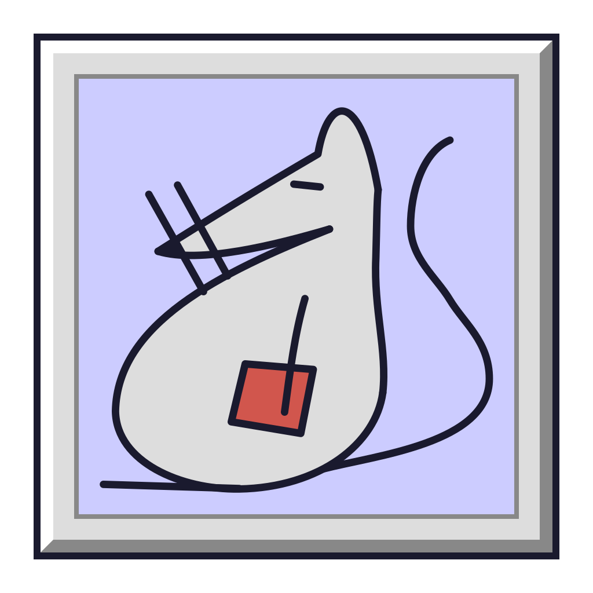

<p align="center">
  
</p>

<h1 align="center">Nezuyomi</h1>

<p align="center">
  A lightweight manga + anime app for Linux.
</p>

---

## Highlights
- **Minimal** — a late-90s "platinum" desktop theme in plain GTK4 CSS

## Built with

Rust · GTK4 (`gtk4-rs`) · QuickJS (`rquickjs`) · SQLite (`rusqlite`)

## Building

Requires Rust (stable), GTK 4.14+ development files and `mold` (Fedora: `sudo dnf install gtk4-devel gcc mold`).

```sh
cargo build --release
./target/release/nezuyomi
```

Install the desktop entry and icons:

```sh
./tools/install-desktop.sh
```

## Sources

Nezuyomi ships no content sources. It reads local folders and comic archives (`~/Manga/`),
and loads JavaScript source extensions placed in `~/.local/share/nezuyomi/extensions/`.
You are responsible for the sources you add and for respecting the rights of content owners.

## License

[GPL-3.0-or-later](LICENSE)
